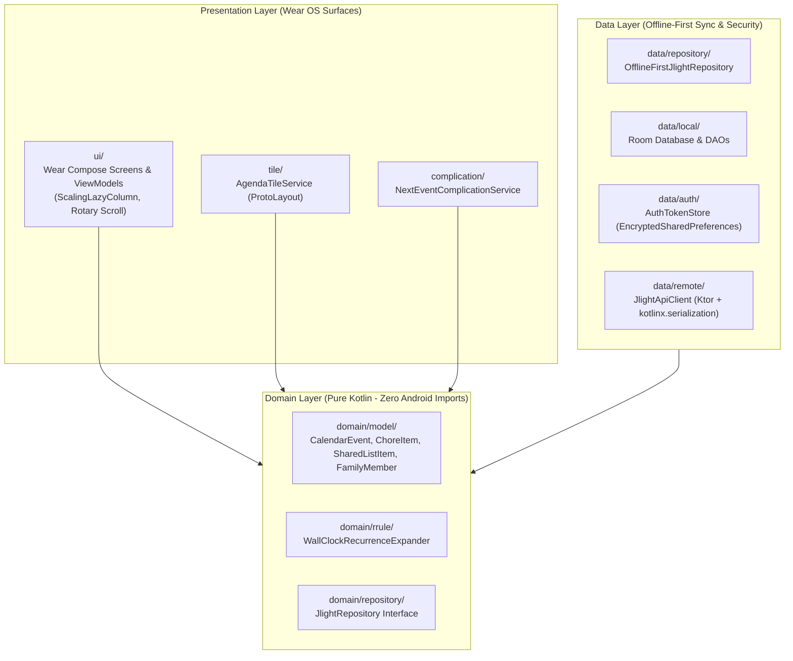

# System Architecture Overview (`JlightCalendar-wearOS`)

This document defines the high-level architecture, package boundaries, and upstream integration contracts for **JlightCalendar-wearOS**, the native Wear OS companion to [`tomasmed/JlightCalendar`](https://github.com/tomasmed/JlightCalendar).

---

## 1. Architectural Alignment with Upstream `JlightCalendar`

`JlightCalendar-wearOS` acts as an authenticated first-class client of the hosted `JlightCalendar` service (`E:\JlightCalendar`). Every architectural decision in this repository aligns with the upstream ADRs:

| Upstream JlightCalendar ADR | Upstream Principle | Wear OS Companion Implementation |
| :--- | :--- | :--- |
| **ADR 0013**: *Recurring Events & Local Wall-Clock Time* | Event dates (`YYYY-MM-DD`) and times (`HH:mm`) are stored as local wall-clock strings and expanded via RFC 5545 `rrule` + `exdates` without `.toISOString()` UTC shifts. | `WallClockRecurrenceExpander` in `domain/rrule/` uses `java.time.LocalDate` and `java.time.LocalTime` exclusively. See [ADR 0004](../adr/0004-offline-first-room-sync-and-wall-clock-rrule.md). |
| **ADR 0015**: *Autonomous Agent Identity, PATs & Handshakes* | External devices and agents authenticate with `Bearer jlight_ag_...` tokens minted via `/api/agent/connect` (Device Code `BOT-XXXX` or Join Code `GLX-XXXXX`). | Watch pairs via QR code (`/?claimBot=BOT-XXXX`) or Join Code, storing the scoped PAT in `EncryptedSharedPreferences`. See [ADR 0003](../adr/0003-device-code-auth-and-encrypted-pat-storage.md). |
| **ADR 0016**: *Material Archetype Theme Engine* | High-contrast **OSL (Fluorescent Light-Spill)** palette on dark surfaces; multi-member events split colors across assigned family members. | Wear Compose theme uses AMOLED true-black (`#000000`) backgrounds with vibrant OSL member accent bars and pills. See [ADR 0002](../adr/0002-kotlin-compose-wearos-stack.md). |
| **ADR 0019**: *Hosted Service First* | Devices connect to the hosted Next.js + Turso cloud backend while maintaining resilient local caches for instant rendering. | Room SQLite acts as the offline-first Single Source of Truth on the watch, synchronized by Ktor + `WorkManager`. |

---

## 2. Clean Architecture Layering & Package Structure

All application code resides in `:app` under `dev.tomasmed.jlight.wear`, separated into three strict layers:

### Package Boundaries & Dependency Rules
1. **`dev.tomasmed.jlight.wear.domain`** *(Pure Kotlin)*:
   * Contains immutable domain models (`CalendarEvent`, `EventOccurrence`, `ChoreItem`, `SharedListItem`, `PairingSession`), `WallClockRecurrenceExpander`, and repository interfaces.
   * **Constraint**: Must **never** import `android.*`, `androidx.room.*`, or `io.ktor.*`. This guarantees 100% of domain logic executes in milliseconds via local JVM unit tests (`./gradlew testDebugUnitTest`).
2. **`dev.tomasmed.jlight.wear.data`** *(Data & Infrastructure)*:
   * **`remote/`**: Ktor HTTP client (`JlightApiClient`) and `@Serializable` DTOs matching upstream JSON payloads. Automatically attaches `Authorization: Bearer jlight_ag_...`.
   * **`local/`**: Room database (`JlightWearDatabase`), entities, and reactive `Flow` DAOs.
   * **`auth/`**: `AuthTokenStore` wrapping `EncryptedSharedPreferences` for storing the PAT, bound `galaxyId`, and server base URL.
   * **`repository/`**: `OfflineFirstJlightRepository` coordinating local Room reads with background Ktor refresh and optimistic mutations.
3. **`dev.tomasmed.jlight.wear.ui` / `tile` / `complication`** *(Wear OS Presentation)*:
   * **`ui/`**: Jetpack Compose for Wear OS screens (`PairingScreen`, `AgendaScreen`, `EventDetailScreen`, `ChoresChecklistScreen`).
   * **`tile/`**: `AgendaTileService` rendering the next upcoming events via `androidx.wear.protolayout`.
   * **`complication/`**: `NextEventComplicationService` providing `SHORT_TEXT` complication data to the active watch face.

---

## 3. Upstream REST API Contract Matrix

The watch communicates with the following `JlightCalendar` endpoints:

| Watch Capability | Method & Endpoint | Auth Required | Request / Query Payload | Response Summary |
| :--- | :--- | :--- | :--- | :--- |
| **Start QR Pairing** | `POST /api/agent/connect` | Public | `{ "agentName": "Galaxy Watch", "rune": "⌚", "requestedScope": "standard" }` | `200 OK`: `{ "deviceCode": "...", "userCode": "BOT-XXXX-XXXX", "verificationUri": "https://.../?claimBot=...", "expiresIn": 900, "interval": 3 }` |
| **Poll QR Pairing** | `GET /api/agent/connect?deviceCode=...` | Public | Query param `deviceCode` | `202/200`: `{ "status": "pending" \| "approved", "token": "jlight_ag_...", "galaxyId": "...", "memberId": "..." }` |
| **Direct Join Code** | `POST /api/agent/connect` | Public | `{ "joinCode": "GLX-XXXX-XXXX", "agentName": "Galaxy Watch", "rune": "⌚" }` | `200 OK`: `{ "status": "approved", "token": "jlight_ag_...", "galaxyId": "...", "galaxyName": "...", "memberId": "..." }` |
| **Fetch Events** | `GET /api/events?galaxyId=...` | `Bearer jlight_ag_...` | Query param `galaxyId` | `{ "events": [ { "id", "galaxyId", "title", "startTime", "endTime", "isAllDay", "rrule", "exdates", "memberId", "memberIds" } ] }` |
| **Create Quick Event** | `POST /api/events` | `Bearer jlight_ag_...` | `{ "galaxyId", "title", "startTime", "endTime", "isAllDay": false }` | `200 OK`: `{ "success": true, "event": { ... } }` |
| **Fetch Chores** | `GET /api/chores?galaxyId=...` | `Bearer jlight_ag_...` | Query param `galaxyId` (`&date=YYYY-MM-DD`) | `{ "chores": [ { "id", "title", "memberId", "completed", "points", "recurrenceType", "frequency" } ], "starBalances": {...}, "members": [...] }` |
| **Toggle Chore** | `PATCH /api/chores` | `Bearer jlight_ag_...` | `{ "choreId": "...", "date": "YYYY-MM-DD" }` | `200 OK`: `{ "success": true, "completed": true, "starBalances": { ... } }` |
| **Fetch Shared Lists** | `GET /api/lists?galaxyId=...` | `Bearer jlight_ag_...` | Query param `galaxyId` (`&type=grocery`) | `{ "items": [ { "id", "title", "completed", "category", "addedByMemberId" } ], "members": [...] }` |
| **Toggle List Item** | `PATCH /api/lists` | `Bearer jlight_ag_...` | `{ "id": "...", "completed": true }` | `200 OK`: `{ "success": true }` |
