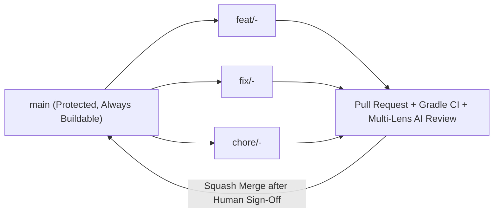
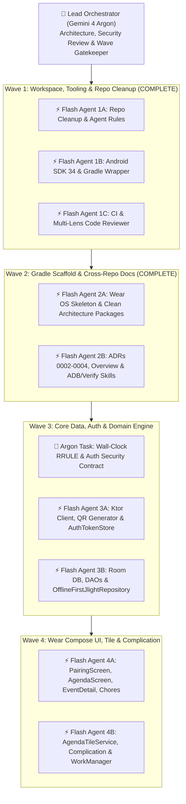

# The Agentic SDLC: Branching, SDD & Multi-Agent (`/boost`) Orchestration Guide

This document defines how human maintainers and AI coding agents collaborate in **JlightCalendar-wearOS**, including our branching strategy, Spec-Driven Development (SDD) lifecycle, and multi-agent division of labor between **Gemini 4 Argon** and **Gemini 3.8 Flash**.

---

## 1. Branching Strategy (Trunk-Based Feature Branches)



1. **`main` is Protected**: Never commit directly to `main`. All changes enter via Pull Requests from `feat/*`, `fix/*`, `chore/*`, or `docs/*` branches.
2. **Why Standard Feature Branches Instead of Concurrent Git Worktrees**:
   * Unlike Node.js workspaces, the Android Gradle Daemon and Kotlin compiler maintain file locks on `.gradle/` and `app/build/` per directory path on Windows.
   * Working on standard feature branches (or at most a single active worktree) avoids JVM daemon contention and file-lock failures on Windows.
3. **Mandatory Verification & Review Gates**:
   * Local gate before push: `.\gradlew.bat check lintDebug assembleDebug`
   * GitHub Actions CI gate: `.github/workflows/ci.yml`
   * Multi-Lens AI PR Review gate: `.github/workflows/code-review.yml` (`tomasmed/ci-code-reviewer@master` configured via `.ci-reviewer.yml`)
   * Human-in-the-loop verification sign-off prior to merge.

---

## 2. Multi-Agent (`/boost`) Execution Strategy: Argon vs. Gemini 3.8 Flash

To maximize speed and cost-efficiency without sacrificing architectural rigor, we use a **Hub-and-Spoke Multi-Agent Topology**:

* **Lead Architect & Wave Orchestrator (`Gemini 4 Argon`)**:
  * Owns system design, cross-repo contract alignment with `E:\JlightCalendar`, security reviews (`EncryptedSharedPreferences` PAT handling), complex temporal algorithms (`WallClockRecurrenceExpander` edge cases), and wave boundary verification.
* **Specialized Execution Subagents (`Gemini 3.8 Flash`)**:
  * Execute well-scoped, parallelizable implementation tasks with clear input/output contracts: Ktor DTOs, Room entities/DAOs, Wear Compose screens, ProtoLayout Tiles, Complications, documentation, and unit test suites.

### Wave Execution Topology



### Agent Role & Model Assignment Matrix

| Subagent Role | Model Tier | Owned Directories / Files | Verification Gate |
| :--- | :--- | :--- | :--- |
| **Lead Orchestrator & Architect** | **Gemini 4 Argon** | `docs/adr/`, `domain/rrule/`, cross-wave integration & review | `.\gradlew.bat check lintDebug assembleDebug` |
| **Data & Network Subagent** | **Gemini 3.8 Flash** | `app/src/main/java/dev/tomasmed/jlight/wear/data/**`, `app/src/test/**/data/**` | `.\gradlew.bat testDebugUnitTest` |
| **Wear Compose UI Subagent** | **Gemini 3.8 Flash** | `app/src/main/java/dev/tomasmed/jlight/wear/ui/**` | `.\gradlew.bat lintDebug assembleDebug` |
| **Tiles & Complications Subagent** | **Gemini 3.8 Flash** | `app/src/main/java/dev/tomasmed/jlight/wear/tile/**`, `complication/**` | `.\gradlew.bat check assembleDebug` |
| **CI PR Reviewer** | **Gemini 3.8 Flash** | `.ci-reviewer.yml` (4 specialized lenses in GitHub Actions) | Automated PR Review comment |

---

## 3. The 6-Stage Spec-Driven Development (SDD) Lifecycle

```text
 ┌───────────────┐     ┌───────────────┐     ┌───────────────┐
 │  1. SPECIFY   │ ──▶ │   2. PLAN     │ ──▶ │ 3. IMPLEMENT  │
 │ (specs/active)│     │ (Argon Design)│     │ (Flash + TDD) │
 └───────────────┘     └───────────────┘     └───────┬───────┘
                                                     │
 ┌───────────────┐     ┌───────────────┐             ▼
 │   6. MERGE    │ ◀── │   5. REVIEW   │ ◀── ┌───────────────┐
 │ (Human Gate)  │     │(Multi-Lens AI)│     │  4. VERIFY    │
 └───────────────┘     └───────────────┘     │ (./gradlew)   │
                                             └───────────────┘
```

1. **Specify (`specs/active/spec.md`)**: Define user stories, upstream API endpoints, and edge cases.
2. **Plan (`specs/active/plan.md` & `tasks.md`)**: Argon agent defines file boundaries and atomic tasks, tagging each task with `[Argon]` or `[Flash]`.
3. **Implement**: Subagents execute tasks sequentially or in non-overlapping parallel waves using JVM TDD.
4. **Verify**: Run `.\gradlew.bat check lintDebug assembleDebug`.
5. **Review**: Multi-lens review checks Architecture, OWASP Security, Test Integrity, and Round-Screen UX.
6. **Merge**: Squash-merge feature branch to `main` after human sign-off.
